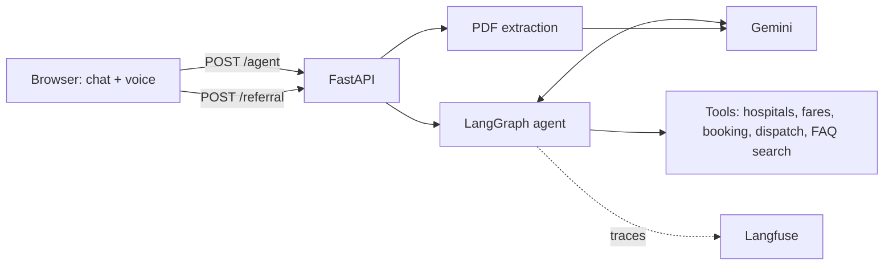
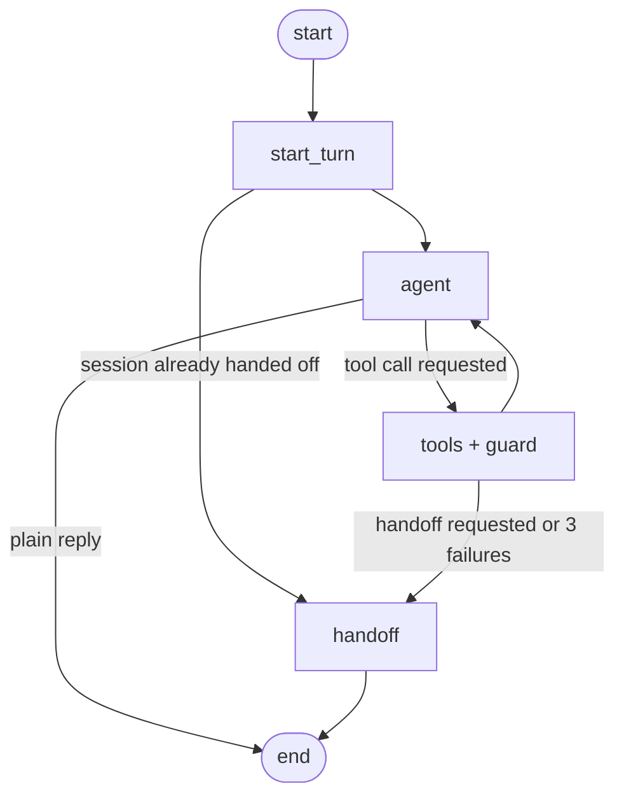

# Ambulance Assistant

A voice-enabled AI assistant that books an ambulance in a single chat, in Hindi or English. A Gemini agent built with LangGraph decides which tools to call, and the code, not the prompt, enforces the safety rules.

> **Demo only.** Every hospital, ambulance and fare in this project is invented, and no real ambulance is ever dispatched. In a real emergency, call **112** (India).

<!-- Add a screenshot or GIF here once you have one:  -->

## What it does

- **One conversation to book.** The agent collects name, phone, pickup area, hospital and ambulance type, shows a fare summary, and books only after the user confirms.
- **Hindi and English, text or voice.** Speech in and out uses the browser's built-in speech APIs (Chrome or Edge).
- **Emergency mode.** If the user describes an urgent situation, the agent asks only for the pickup area and dispatches the nearest free ambulance without a confirmation step. A fixed "call 112" banner is added by code. The agent never judges severity and never gives medical advice.
- **PDF referral upload.** Upload a referral letter and Gemini extracts the transfer details (patient, hospitals, equipment needed). The user reviews them and clicks to use them.
- **Service FAQ with citations.** Questions about ambulance types, fares, payment and cancellation are answered from a small set of documents using hybrid retrieval (vector search + BM25, merged with reciprocal rank fusion).
- **Human handoff.** If the user asks for a person or wants to cancel, or tools fail three times in a row, the graph routes to a handoff node with a fixed reply.
- **Live booking panel** showing what the agent has understood so far.
- **Tracing and feedback.** Every turn is traced in Langfuse (optional), and 👍/👎 clicks are stored as scores on the trace.

## How it works

### Request flow



### Agent graph



### Design decisions

1. **Safety rules live in code, not in the prompt.** `create_booking` is refused unless `prepare_booking` ran in an earlier turn with identical details. The model can ask to book, but code decides whether it is allowed. These rules are tested without any LLM (`test_guard.py`), so they pass or fail the same way every time.
2. **Code does the numbers.** Distances, fares and ETAs come from plain functions in `tools.py`. The model only chooses which tool to call and explains the result.
3. **Errors come back as data.** Tools return `{"error": ...}` with useful hints (for example the list of known areas), so the model can recover instead of crashing.
4. **Uploaded documents are untrusted input.** The extraction prompt tells the model to ignore instructions inside the PDF, but that is only one layer. The output is forced into a fixed schema, free-text fields are never forwarded to the chat, and nothing happens until the user clicks, after which the normal booking guard still applies.
5. **Built by hand first, then ported to LangGraph.** I first wrote the tool-calling loop myself to understand it, then moved it to LangGraph for explicit routing, checkpointed state, and tracing hooks. The guard, tools and mock data did not change.

## Tech stack

Python 3.13, FastAPI, Uvicorn, Google Gemini (via LangChain), LangGraph, Pydantic, Langfuse (optional), fastembed (`bge-small`), rank-bm25, plain JavaScript with the browser Web Speech API.

## Run it locally

You need Python 3.10+ (developed on 3.13) and a free [Gemini API key](https://aistudio.google.com/).

```powershell
git clone https://github.com/saranshunity/ambulance-assistant.git
cd ambulance-assistant
python -m venv venv
venv\Scripts\Activate.ps1
pip install -r requirements.txt
copy .env.example .env      # then edit .env and add your keys
python -m uvicorn main:app --reload
```

Open <http://127.0.0.1:8000>. The first start downloads a small embedding model (about 70 MB) for the FAQ search.

On macOS or Linux, activate the environment with `source venv/bin/activate` and copy the file with `cp`.

### Configuration

| Variable | Required | Purpose |
|---|---|---|
| `GEMINI_API_KEY` | yes | Gemini API key |
| `GEMINI_MODEL` | yes | Model name. Use one your key can access (models change often) |
| `LANGFUSE_*` | no | Tracing and feedback scores. Copy the exact lines from your Langfuse project settings. Without them the app runs untraced |

Never commit your `.env` file.

## Evaluation

`run_eval.py` replays 25 test conversations through the agent and checks the outcome in code: which tools were called and with which arguments, whether a booking or dispatch happened, the saved details, and required or forbidden text in the reply. It checks outcomes and tool sequences, not exact wording. Each run is traced in Langfuse, with a pass or fail score per case.

| Run | Passed | booking | guard | emergency | faq | handoff | honesty |
|---|---|---|---|---|---|---|---|
| baseline | 24/25 | 5/5 | 3/3 | 5/5 | 5/5 | 3/4 | 3/3 |
<!-- Add the rerun row here after you run: python run_eval.py baseline2 --pause 8 -->

The one failure was a wrong assumption in my test, not a bug in the assistant. I expected three failed tool calls in a row to trigger a handoff, but after the first failure the model answered from the list of known areas without calling the tool again. The three-failure counter is now covered by a unit test that does not use the model.

```powershell
python run_eval.py baseline --pause 8
```

A full run uses a noticeable share of the free Gemini quota and can take 15 to 25 minutes. It saves results after every case and resumes if interrupted.

**What the eval does not prove:** 25 cases is a small set, several text checks are loose, and the model varies between runs, so a single pass is weak evidence.

## Tests

```powershell
python test_tools.py       # mock tools, no LLM
python test_guard.py       # confirm-before-booking guard, no LLM
python test_handoff.py     # three-failure handoff counter, no LLM
python test_faq.py         # FAQ retrieval
```

## Project structure

```
main.py             FastAPI routes
graph_agent.py      LangGraph agent, state, routing and the guard
prompts.py          System prompt and emergency banner
tools.py            Mock hospitals and ambulances, and the tool functions
faq.py              FAQ retrieval (LangChain, BM25 + vector, RRF)
faq/                FAQ source documents (invented)
referral.py         PDF referral extraction
retry.py            Retry helper for Gemini rate limits and overload
static/index.html   Chat UI with voice and feedback buttons
run_eval.py         Eval runner
evals/              Test cases and saved run results
test_*.py           Tests
```

## Limitations

- **Mock data.** Areas, hospitals, ambulances and fares are invented. Distances use a simple grid, not real maps.
- **State is in memory.** Conversations and the mock fleet reset when the server restarts, and the app can only run as a single instance. A database-backed checkpointer would fix this.
- **After a handoff, the bot stops handling the session.** The fixed reply points to 112, but a real system would keep an emergency path open.
- **Privacy.** Chrome's speech recognition sends audio to Google, uploaded PDFs go to the Gemini API, and traces go to Langfuse if enabled. Use invented details only.
- **Free-tier limits.** Gemini can return rate-limit or overload errors. The app retries, but heavy use may fail.
- **Hindi voice output** depends on the voices installed on your device.
- **Not a medical product.** The assistant never gives medical advice.

## Roadmap

- Docker image and cloud deployment
- Rate limiting and a daily cap on model calls for a public demo
- Database-backed conversation state
- Image input for referral photos

## License

MIT. Add a `LICENSE` file when you publish.
